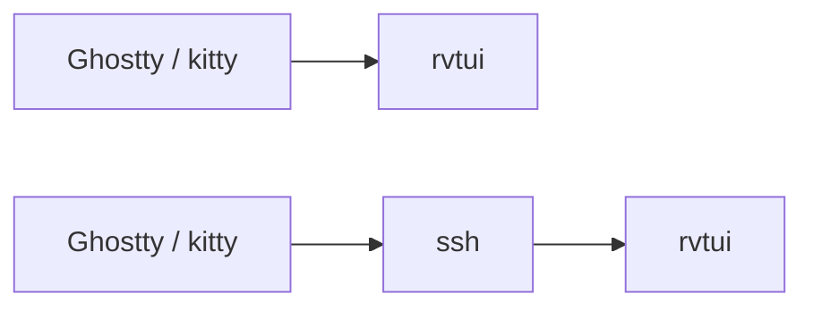
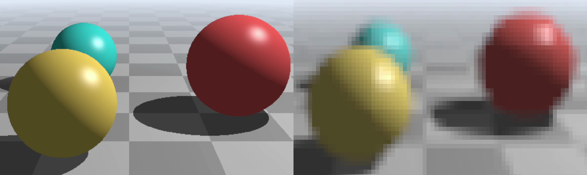
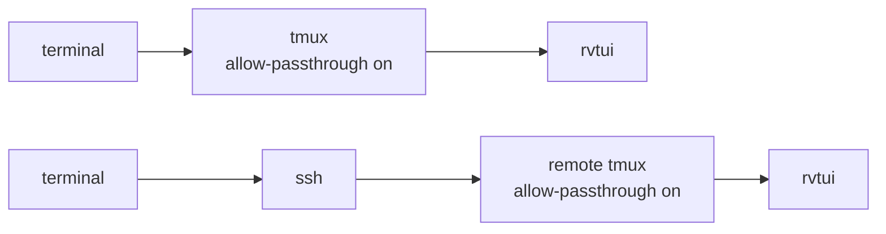
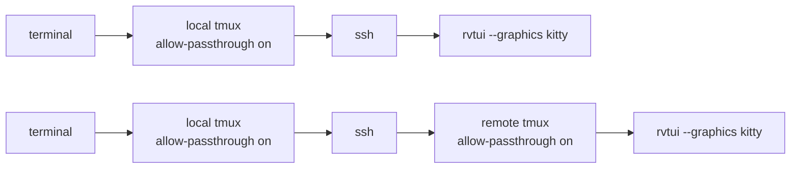

# Terminal setup

Run **`rvtui --doctor`** first: it checks your terminal and tmux, and says what to add.

```console
$ rvtui --doctor
rvtui doctor
  ✓ terminal     TERM=tmux-256color TERM_PROGRAM=tmux tmux client=xterm-ghostty
  ✓ tmux         version 3.8
  ✓ passthrough  allow-passthrough on
  ✓ cell size    13x28 px
  ✓ truecolor    tmux client has RGB
  ✓ clipboard    set-clipboard on
  · graphics     kitty
  · transfer     file: pixels go through temp files, not the pty
```

What rvtui needs depends on your terminal app and on what runs between it and rvtui.
tmux keeps terminal sessions alive and splits them into panes; if you don't use it, skip
the tmux sections.

## Ghostty or kitty: just works



## Other terminals: half-blocks

iTerm2, WezTerm, Warp, Konsole, Alacritty, foot, GNOME Terminal, xterm, Windows Terminal,
Terminal.app, VS Code and zellij show half-blocks: each character cell shows two pixels,
one above the other. Everything else works the same.



*Full resolution on the left (Ghostty), half-blocks on the right.*

## tmux: one line in tmux.conf



In every tmux between the terminal and rvtui, add to `~/.tmux.conf`, then
`tmux source-file ~/.tmux.conf`:

| tmux.conf | What for |
|-----------|----------|
| `set -g allow-passthrough on` | images (needed) |
| `set -as terminal-features ',xterm*:RGB'` | true colour |
| `set -g set-clipboard on` | `y` copies reach the clipboard |

Use tmux 3.8 or later: 3.7 drops images in split panes.

## tmux, then ssh: add --graphics kitty

When tmux runs on your machine and you ssh from inside it, rvtui on the remote can't ask
your terminal what it supports. Tell it:



`--graphics kitty` skips the check, so a missing setting leaves images blank instead of
falling back to half-blocks. (`--graphics halfblock` forces half-blocks.)

## Over ssh

Images go through the ssh connection. While a sequence plays, rvtui paces them to what
the link carries, so a pause stops the picture at once instead of after a backlog
drains. It measures the link as it plays: from the terminal's answers to a query sent
after each frame, or, inside tmux on the remote host, from the bytes tmux sent your
client. Until measured it assumes `--link-rate` (4M a second); `--link-rate 0` turns
pacing off. Playback frames are sized to fit the link, so CG with flat areas plays
sharper than grainy footage.

Frames played over ssh stay in the terminal (up to `--terminal-cache`, 256M by
default), so rvtui shows them again without sending any pixels. It stores them ahead
too: paused on a sequence, it sends the play range's frames while the link is idle, so
playback starts from the terminal; playing, it stays ahead of the playhead. On the
playbar, frames the terminal keeps are cyan, frames only decoded (in rvtui) green; the
status bar shows both caches, `cache remote … local …`.
Playback frames are sized so the whole range fits in under half of it, when that is
sharper than what the link carries in real time: the view before a pan or a zoom stays
kept too (dim cyan on the playbar), and plays from the terminal again when you go back. Kitty and Ghostty keep 320 MB of images by
default; to keep more frames, raise theirs (Ghostty: `image-storage-limit`, at most
4 GiB) and `--terminal-cache` with it (e.g. `3.9G`). `S` shows the link, what a frame
costs and what both caches hold.
How the pixels travel (shared memory, temp files or inline) is chosen for you by the
default, `--transfer auto`; set `--transfer` yourself only if images stay blank (see
[Command line](reference/cli.md#options)).
